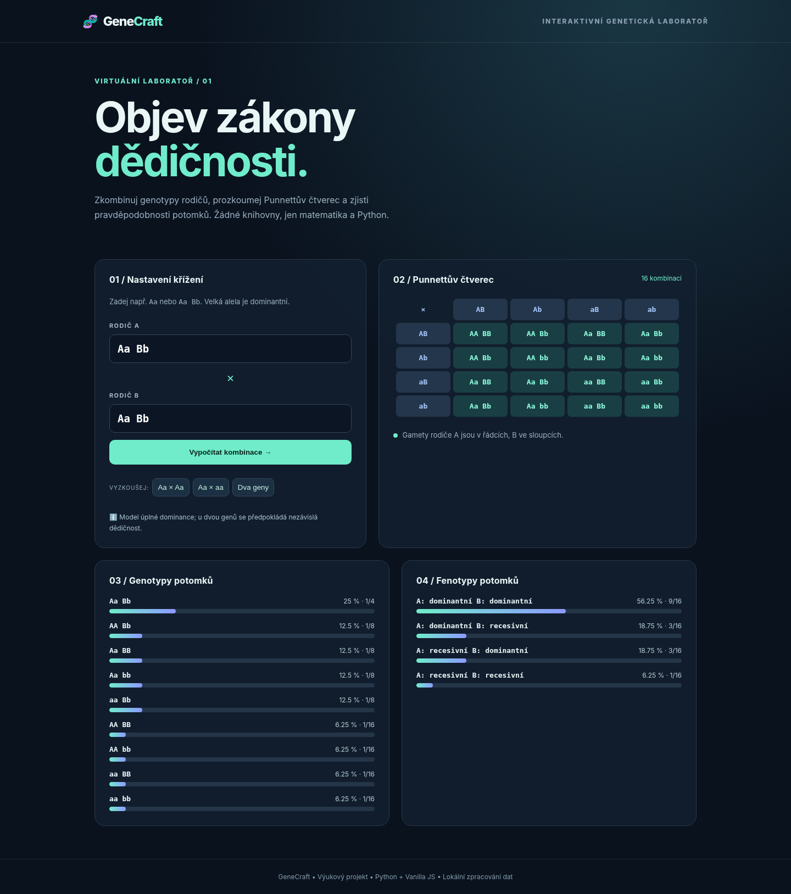

# 🧬 GeneCraft — interaktivní genetická laboratoř

Moderní výuková webová aplikace pro Mendelovy zákony dědičnosti. Zadej genotypy rodičů a ihned uvidíš **Punnettův čtverec**, možné gamety a rozdělení genotypů i fenotypů potomků.



## Co umí
- Monohybridní a dihybridní křížení (například `Aa × aa`, `Aa Bb × Aa Bb`).
- Výpočet přesných pravděpodobností pomocí `fractions.Fraction`.
- Responsivní tmavé rozhraní a živé grafy bez externích závislostí.
- Validaci genotypů a automatické testy.

## Spuštění
Potřebuješ **Python 3.10+**. V této složce spusť:

```bash
python app.py
```
Otevři **http://127.0.0.1:8765**. Vlastní port: `python app.py --port 9000`.

## Testování
```bash
python -m unittest discover -s tests -v
```

## Struktura
- `genetics.py` — výpočty, validace a pravděpodobnosti.
- `app.py` — lokální HTTP server a JSON API `POST /api/cross`.
- `static/` — HTML, CSS a JavaScript.
- `tests/` — automatické testy.

## Příklad API
```bash
curl -X POST http://127.0.0.1:8765/api/cross -H "Content-Type: application/json" -d '{"parent1":"Aa","parent2":"Aa"}'
```

> **Výukové zjednodušení:** model předpokládá úplnou dominanci a u dvou genů nezávislou kombinovatelnost. Není určen k individuální genetické diagnostice.

**Stack:** Python · HTML · CSS · Vanilla JavaScript · unittest. Licence MIT.
